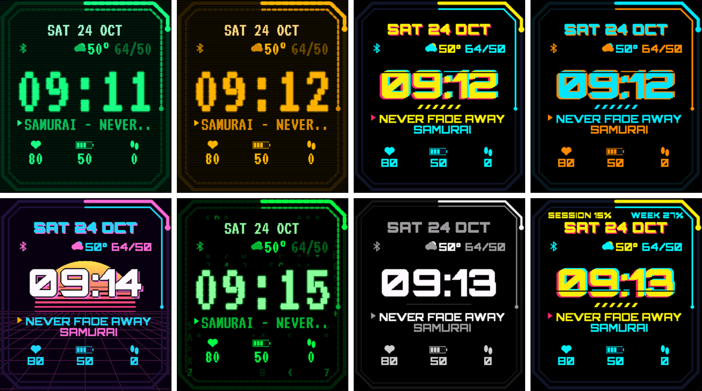
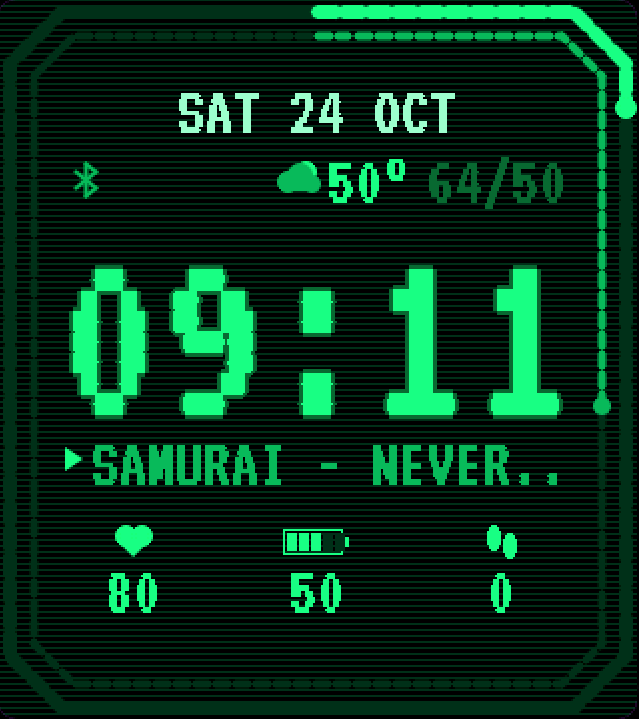
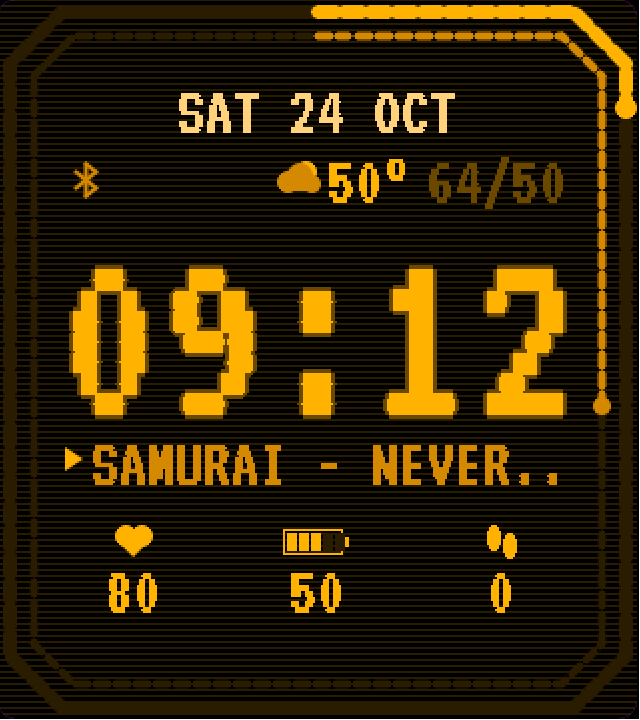
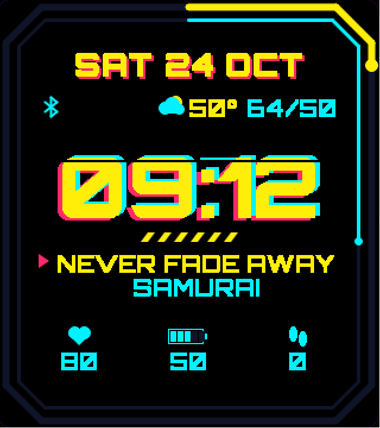
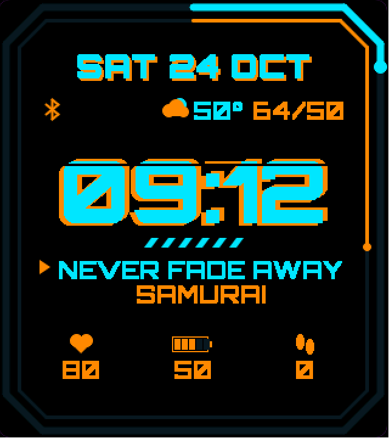
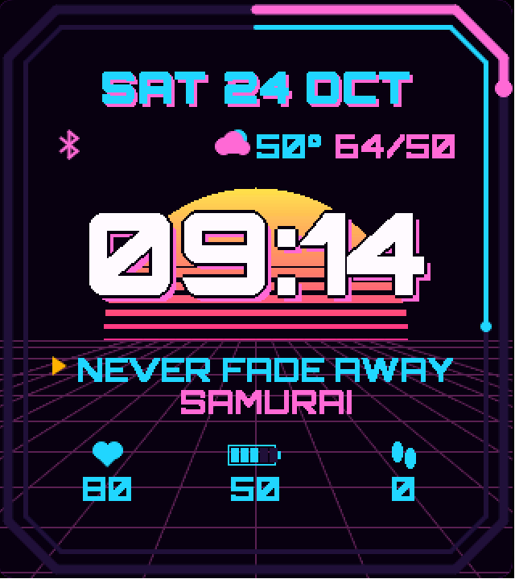
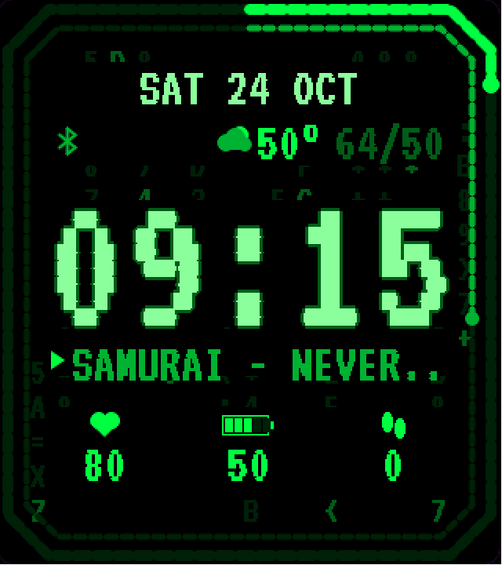
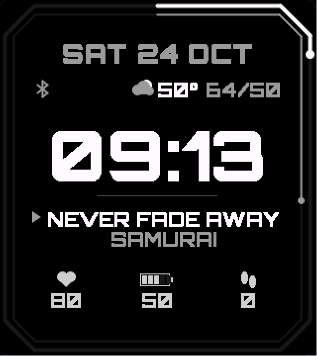
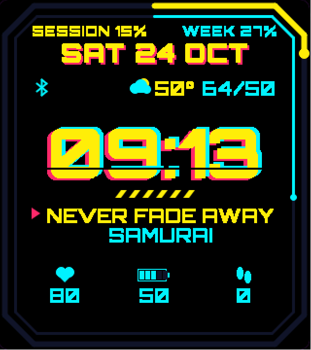

# Holo Terminal

A Garmin watch face that shows your **Claude usage** as two rings around the screen, plus the
song playing on your phone, weather, heart rate, battery and steps. Seven themes.



| Wasteland | Amber | Neon | Grid |
|---|---|---|---|
|  |  |  |  |
| **Outrun** | **Rain** | **Mono** | **Neon, ring labels on** |
|  |  |  |  |

## Reading the rings

Both rings fill clockwise from the top center.

- **Outer ring:** your 5-hour session limit.
- **Inner ring:** your weekly limit.

A ring changes to the theme's warning color past 80%, and dims if the numbers are more than
6 hours old. The **Label the Claude rings** setting writes `SESSION 12%` and `WEEK 27%` at the
top until you know which is which.

The numbers are for your whole Claude account, whichever device you use it on.

## What's in here

| Folder | What it is |
|---|---|
| `holoface/` | The watch face (Monkey C, Connect IQ). |
| `claude-usage/` | A Claude Code status line script that publishes your usage to a secret GitHub gist the face reads. |
| `holo-link/` | **Holo Link**, an optional Android companion app that sends the playing song (Spotify or any player) and weather to the face. |
| `fonts-src/` | VT323 and Orbitron, both SIL Open Font License, and `gen_fonts.py` turns them into Garmin bitmap fonts. |

## Setup

### 1. Claude usage

Claude Code only reports plan usage to the status line, and only on Pro and Max plans, so the
usage comes from there. It updates while a Claude Code session is running.

You need the [GitHub CLI](https://cli.github.com) signed in (`gh auth login --scopes gist`) and Python 3.

```
python claude-usage/install.py --apply
```

This creates a secret gist, installs the status line script in `~/.claude-usage/`, adds the
`statusLine` entry to `~/.claude/settings.json` (backing it up first), and prints your gist's
raw URL. Leave out `--apply` to add the setting yourself.

Why a gist: on Android, a Garmin watch can only fetch `https` addresses with a real certificate,
so it can't read a file off your PC.

### 2. The watch face

Currently built for the **Venu Sq 2** (320x360). Other watches need their own layout.

Build it with the [Connect IQ SDK](https://developer.garmin.com/connect-iq/sdk/), a developer key
(`developer_key.der` in the repo root) and Java 17+:

```
./build.ps1 -Release
```

Then either:

- **Sideload:** plug the watch into a PC with its charging cable, copy `holoface/bin/HoloFace.prg`
  into `GARMIN/APPS` on the watch, unplug, and pick **Holo Terminal** as your watch face. Phone
  settings may not show up for sideloaded faces, so put your gist URL and theme in a
  `personal.json` (see below) and build with `-Personal`.
- **Connect IQ store beta:** build the package with `monkeyc -e -r ...`, upload it as a beta app,
  and install from the store link on your phone. Then set the theme and **Claude usage URL**
  in Garmin Connect > Connect IQ > Holo Terminal > Settings.

`personal.json` (gitignored):

```json
{ "usageUrl": "https://gist.githubusercontent.com/<you>/<gist id>/raw/usage.json", "theme": 2, "labels": false }
```

Themes: 0 Wasteland, 1 Amber, 2 Neon, 3 Grid, 4 Outrun, 5 Rain, 6 Mono.

### 3. Holo Link (optional, Android)

Garmin doesn't let watch faces read what your phone is playing, and on some phones Garmin's own
weather never reaches the watch. Holo Link fills both gaps: it watches the phone's media
sessions and sends the title, artist and play/pause to the face the moment they change, and
every 15 minutes it sends the weather for the phone's location from
[Open-Meteo](https://open-meteo.com) (free, no key).

Build it with Gradle (`holo-link/gradlew assembleDebug`) and install the APK. Then on the phone:

- **Notification access** for Holo Link (the app has a button for it). Android only shows other
  apps' media sessions to apps with this.
- **Location: Allow all the time**, for the weather.

It needs the Garmin Connect app installed and paired to the watch.

## How it fits together

```
Claude Code status line --gh--> secret gist --https, every 5 min--> watch face
Phone media + Open-Meteo --> Holo Link --Connect IQ messages--> watch face
```

The face's background service wakes every 5 minutes (Garmin's shortest interval) to fetch the
gist, and wakes immediately on each Holo Link message.

## Notes

- Theme names are generic on purpose; the face isn't affiliated with any game or with Anthropic.
- Always-on mode shows only a dim time that shifts each minute, to protect AMOLED screens.

## License

Code: MIT (see `LICENSE`). Fonts: SIL Open Font License 1.1 (`fonts-src/OFL-*.txt`).
